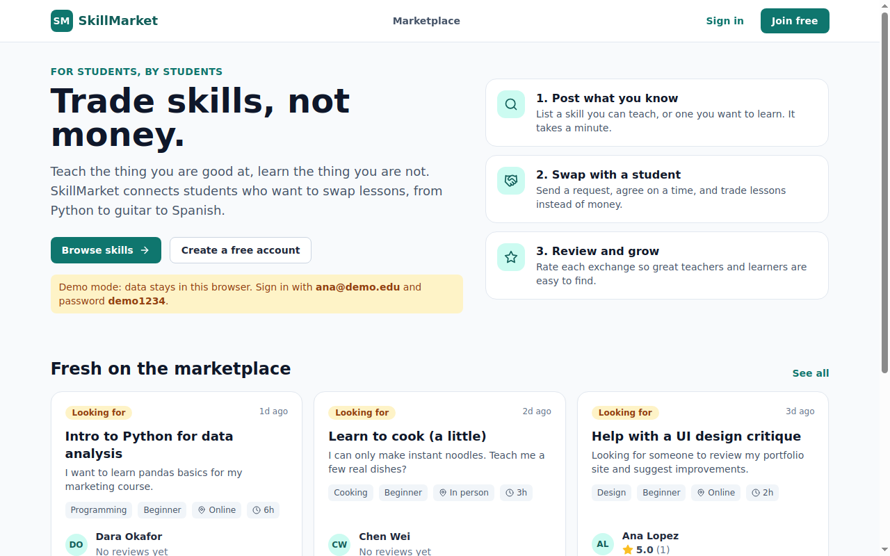
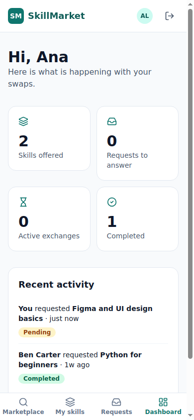
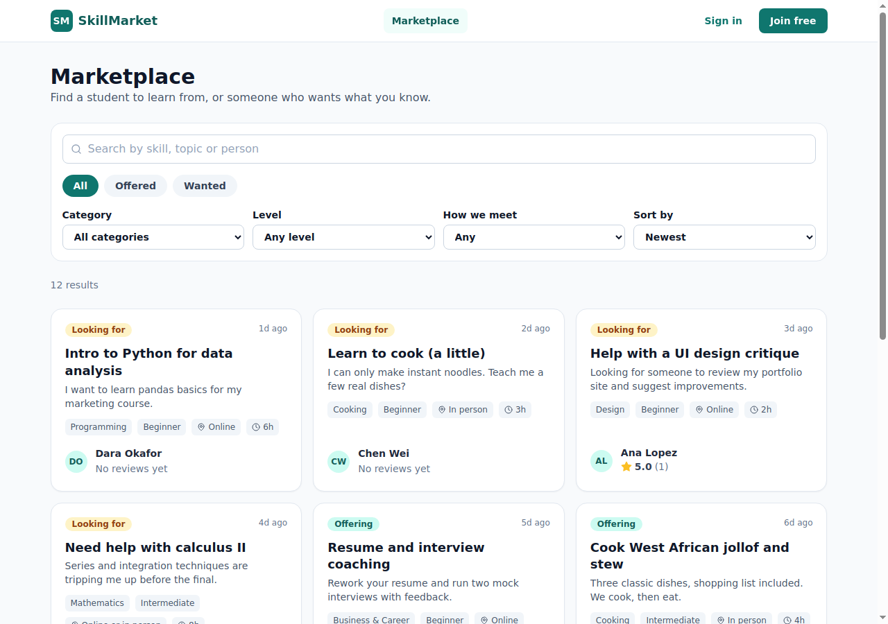
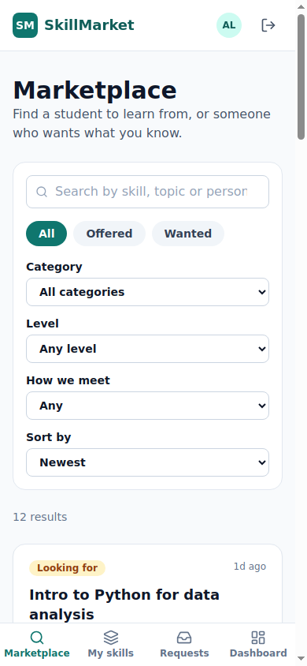
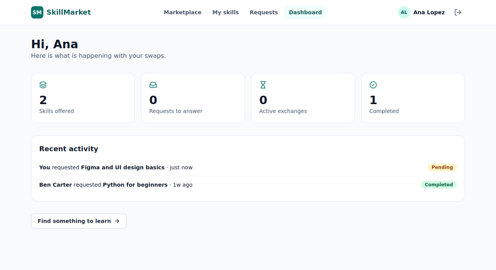

# SkillMarket: React-Based Skill Marketplace Platform with PWA Support

A single-page web app where students **exchange skills**: teach what you know, learn what you don't. Built with
**React + TypeScript + Tailwind CSS**, secure **Supabase authentication**, user dashboards, a component-based
architecture, and **Progressive Web App** support (installable, works offline via a service worker).

> Developed for a hackathon during my B.E. This repository is a clean, tested rebuild of that project, written in 2026;
> the Git history reflects that.

## Screenshots

| Desktop | Phone |
| --- | --- |
|  |  |
|  |  |



*Captured from the production build running in demo mode.*

## Features

- **Authentication**: email/password sign-up and sign-in, protected routes, session persistence
- **Marketplace**: post skills you *offer* or *want*; search; filter by category, level, meeting mode and type; sort by newest, rating or title
- **Exchange workflow**: send a request with a message and what you offer in return; owners accept or decline, requesters can cancel, either side marks an accepted swap as completed
- **Reviews and ratings**: after a completed exchange both people can rate each other; ratings show on skills and profiles
- **Dashboard**: your offers, requests waiting for your answer, active and completed swaps, recent activity
- **Profiles**: edit your own, view others'
- **PWA**: installable, app shell and assets precached so the app opens offline, offline page fallback, "new version available" update prompt, offline banner, last marketplace results kept for offline viewing
- **Responsive and accessible**: mobile bottom navigation, labelled forms, keyboard-friendly dialogs, reduced-motion support

## Run it in 30 seconds (no backend needed)

```bash
npm install
npm run dev
```

With no Supabase settings the app runs in **demo mode**: data lives in your browser's localStorage and is pre-filled with
sample students and skills. Sign in with `ana@demo.edu` / `demo1234` (the sign-in page has a one-click button).
Demo accounts are for trying the app only and are **not secure**.

## Connect a real backend (Supabase)

1. Create a free project at [supabase.com](https://supabase.com).
2. Open **SQL Editor**, paste the contents of `supabase/migrations/0001_init.sql` and run it.
3. Copy `.env.example` to `.env` and fill in **Project Settings -> API**:
   ```
   VITE_SUPABASE_URL=https://your-project.supabase.co
   VITE_SUPABASE_ANON_KEY=your-anon-key
   ```
4. Optional: in **Authentication -> Providers -> Email**, turn off "Confirm email" while developing. If it stays on,
   the app tells new users to check their inbox.
5. `npm run dev`. The app now uses Supabase automatically.

Only the public **anon** key belongs in the front end. Security comes from **row level security** in the database
(never ship a service-role key).

### What the database enforces

`supabase/migrations/0001_init.sql` creates `profiles`, `skills`, `exchange_requests` and `reviews`, plus:

- a trigger that creates a profile at sign-up;
- row level security: everyone can browse skills, profiles and reviews; people edit only their own data; requests are visible only to the two people involved;
- triggers that set a request's owner and starting status on the server (clients cannot fake them) and allow only legal status changes by the right person (pending -> accepted/declined by the owner, pending -> cancelled by the requester, accepted -> completed/cancelled by either);
- reviews only on completed exchanges, only by a participant, only about the other participant, once each.

## Progressive Web App

| Piece | File |
| --- | --- |
| Web app manifest (name, theme, icons incl. maskable, shortcuts) | `public/manifest.webmanifest` |
| Service worker | `public/sw.js` |
| Offline page | `public/offline.html` |
| Build step that injects the list of built files into the service worker | `precacheManifest()` in `vite.config.ts` |
| Registration and update prompt | `src/lib/pwa.ts`, `src/main.tsx` |

How it behaves: the app shell and all built files are precached at install; page navigations try the network first and
fall back to the cached shell (so deep links open offline); built assets are served cache-first; Google Fonts use
stale-while-revalidate; Supabase and all other API calls are never intercepted. A new deployment shows a
"new version is ready" toast and updates when the user taps Refresh.

Try it: `npm run build && npm run preview`, open the app, then in Chrome DevTools -> Application -> Service Workers
tick **Offline** and reload. The service worker is registered only in production builds.

## Tech stack

React 18, TypeScript, Vite, Tailwind CSS, React Router, Framer Motion, Supabase (Auth, PostgreSQL, RLS),
react-hot-toast, Lucide icons, Vitest and Testing Library.

## Architecture

```
src/
  lib/
    service.ts           the Service interface the UI depends on
    localService.ts      demo backend (localStorage), same rules as the database
    supabaseService.ts   Supabase backend
    supabase.ts          picks a backend from environment variables
    rules.ts             who may change a request to which status; dashboard stats
    validation.ts        form and input validation shared by both backends
  context/               app provider (session, profile) and useApp hook
  components/            Layout, SkillCard, SkillForm, Modal, dialogs, shared UI
  pages/                 Landing, Login, Register, Marketplace, SkillDetail, MySkills, Requests, Dashboard, Profile
public/                  manifest, service worker, offline page, icons
supabase/migrations/     database schema, policies and triggers
supabase/tests/          SQL behaviour tests
```

Pages never talk to Supabase directly; they use the `Service` interface. That is why the same UI runs against the
demo backend and the real one, and why the business rules are unit-testable.

## Tests

```bash
npm test                 # 104 tests: services, rules, validation, service worker, PWA registration, and full UI flows
npm run lint
npm run build
```

- **Service layer**: both backends, every status transition, validation, cascades, sorting and filtering
- **UI flows** (simulated browser): sign-in redirects, registration validation, search and filters, requesting a skill, accepting and cancelling, completing and reviewing, adding, editing and deleting skills, profile editing, offline banner and offline results
- **Service worker**: runs `sw.js` in a sandbox with a fake Cache API (precache, cache-first assets, offline navigation fallback, API bypass, cache cleanup, update flow)
- **PWA registration**: production-only registration, update announcement, one-time reload on update, install prompt handling
- **Real browser check** (done manually, not part of `npm test`): the production build was served and driven in headless Chromium. Sign-in, protected-route redirects, dialogs and the phone layout work with no console errors, the service worker installs and precaches the app, and with the web server stopped the app still opens deep links offline.
- **Database**: `supabase/tests/rls_test.sql` runs against real PostgreSQL (CI does this automatically). It checks sign-up profiles, ownership, request privacy, status transitions, review rules and the ratings view:
  ```bash
  psql -v ON_ERROR_STOP=1 -d skilltest -f supabase/tests/stub_auth.sql -f supabase/migrations/0001_init.sql -f supabase/tests/rls_test.sql
  ```

## Deploying

`npm run build` produces `dist/`. Netlify (`public/_redirects`) and Vercel (`vercel.json`) are configured for
single-page routing. Set the two `VITE_SUPABASE_*` variables in the host's settings. Serve over HTTPS (needed for
the service worker and installability).

## Limitations

- The Supabase backend is tested against a fake client and the SQL against plain PostgreSQL with a stand-in `auth`
  schema, not against a live Supabase project. Follow the setup steps once and try a sign-up and a request to confirm.
- PWA behaviour was verified in headless Chromium (service worker install, precache, offline deep links) but not on
  real phones, Safari or Firefox, and the "Add to Home Screen" prompt itself was not exercised. Run a Lighthouse
  audit after deploying.
- Marketplace search on Supabase matches title and description (the demo backend also matches tags and owner names).
- No chat or real-time updates: people see changes on reload or navigation.
- Offline mode is read-oriented: saved pages and the last marketplace results open offline, but sending requests
  needs a connection.
